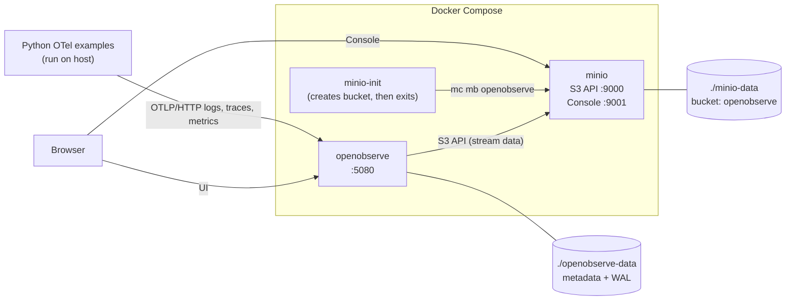

# OpenObserve

Local OpenObserve instance running with Docker, using MinIO as a local S3.

## Quick start

From this project directory, run:

```powershell
docker compose up -d
```

## Services

| Service | URL | Username | Password |
|---------|-----|----------|----------|
| OpenObserve (UI and API) | <http://localhost:5080> | `chapolin@chapolin.com` | `Mudar@1234` |
| MinIO Console | <http://localhost:9001> | `minioadmin` | `minioadmin` |
| MinIO S3 API | <http://localhost:9000> | `minioadmin` (access key) | `minioadmin` (secret key) |

> Change these credentials before using this environment outside your local machine.

## Architecture



Startup order: `minio` (healthy) → `minio-init` (bucket created) → `openobserve`.

## Containers

| Container | Image | Ports | Persistence |
|-----------|-------|-------|-------------|
| `openobserve` | `o2cr.ai/openobserve/openobserve-enterprise:latest` | `5080` | `openobserve-data` |
| `minio` | `pgsty/minio:RELEASE.2026-08-04T00-00-00Z` | `9000`, `9001` | `minio-data` |
| `minio-init` | `pgsty/mc:RELEASE.2026-09-16T00-00-00Z` | — | — |

## Useful commands

Check the container:

```powershell
docker ps --filter name=openobserve
```

View the logs:

```powershell
docker logs -f openobserve
```

Stop:

```powershell
docker stop openobserve
```

Start again:

```powershell
docker start openobserve
```

Remove the container without deleting the data:

```powershell
docker rm -f openobserve
```

## Recreate the installation

Run from this project directory:

```powershell
$dataPath = Join-Path (Get-Location) 'openobserve-data'
New-Item -ItemType Directory -Force $dataPath | Out-Null
docker run -d --name openobserve `
  -v "${dataPath}:/data" `
  -e 'ZO_DATA_DIR=/data' `
  -e 'ZO_ROOT_USER_EMAIL=chapolin@chapolin.com' `
  -e 'ZO_ROOT_USER_PASSWORD=Mudar@1234' `
  -p 5080:5080 `
  o2cr.ai/openobserve/openobserve-enterprise:latest
```

The command above reuses the existing data in `openobserve-data`.

## Docker Compose

Start OpenObserve in the background:

```powershell
docker compose up -d
```

Check the service status:

```powershell
docker compose ps
```

Follow the logs:

```powershell
docker compose logs -f openobserve
```

Stop the service without deleting the data:

```powershell
docker compose down
```

## Local S3 with MinIO

`docker compose up -d` also starts MinIO as a local S3 simulator. OpenObserve
stores its stream data in it by default, so you don't need an AWS account.

- Image: `pgsty/minio` (official `minio/minio` images are no longer
  published; this is the open-source AGPLv3 fork maintained by the community)
- S3 API: <http://localhost:9000>
- Console: <http://localhost:9001> (user `minioadmin` / password `minioadmin`)
- Bucket: `openobserve`, created automatically by the `minio-init` service
- Persistence: `minio-data`

Data is not written to S3 immediately. OpenObserve first keeps ingested data
in its local write-ahead log (`openobserve-data/wal`), then converts it to
Parquet and uploads it to the bucket under `openobserve/files/<org>/<type>/<stream>/`.
How long data stays local is controlled by `ZO_MAX_FILE_RETENTION_TIME`
(OpenObserve default: 600 s). This project sets it to **60 s**, so new data
shows up in MinIO about a minute after ingestion. Searches in the UI work
right away because OpenObserve also reads from the WAL.

To list the uploaded files:

```powershell
docker run --rm --network setup_openobserve_default --entrypoint sh pgsty/mc:RELEASE.2026-09-16T00-00-00Z -c "mc alias set l http://minio:9000 minioadmin minioadmin && mc ls -r l/openobserve"
```

## Persisting data to AWS S3

To use a real S3 bucket instead of MinIO:

1. Copy `.env.example` to `.env` and fill in your bucket details:

   ```powershell
   Copy-Item .env.example .env
   ```

2. Edit `.env` with your AWS credentials, region, and bucket name, and set
   `S3_SERVER_URL=https://s3.<region>.amazonaws.com`.
3. Restart the stack:

   ```powershell
   docker compose up -d
   ```

`ZO_DATA_DIR` (the `openobserve-data` folder) is still used locally for
metadata and the write-ahead log, but the actual stream data is offloaded to
the S3 bucket configured via `ZO_LOCAL_MODE_STORAGE=s3` and the `ZO_S3_*`
variables in `docker-compose.yml`.

If you'd rather use IAM role-based credentials (e.g. running on an EC2
instance) instead of static keys in `.env`, leave `AWS_ACCESS_KEY_ID` and
`AWS_SECRET_ACCESS_KEY` empty — OpenObserve falls back to the standard AWS
credential chain (instance metadata, `~/.aws/credentials`, etc.).

## Python OpenTelemetry samples

The samples in `scripts/sample` send logs, traces, and metrics to OpenObserve
using OTLP over HTTP. They run on the host (outside Docker), so start the stack
first with `docker compose up -d`.

Create the virtual environment and install the dependencies (only once):

```powershell
python -m venv venv
.\venv\Scripts\python.exe -m pip install -r requirements.txt
```

Run the samples from the project directory:

| Sample | Command | Stream in OpenObserve |
|--------|---------|-----------------------|
| Quick example (one log, span, and metric) | `.\venv\Scripts\python.exe scripts\sample\otel_example.py` | `python_sample` |
| Slow process, 3 × 15 s stages with `INFO`/`WARN`/`ERROR` logs | `.\venv\Scripts\python.exe scripts\sample\otel_slow_example.py` | `python_slow_demo` |
| Simulated database connection and queries | `.\venv\Scripts\python.exe scripts\sample\conector_database.py` | `python_db_demo` |

OpenObserve converts hyphens to underscores in stream names. After running a
sample, open <http://localhost:5080>, choose a time range that includes the
execution, select the stream under Logs, Traces, or Metrics, and click
**Run query**.

By default the samples use the `default` organization and the local
credentials above. To override them:

```powershell
$env:OPENOBSERVE_URL = 'http://localhost:5080/api/default'
$env:OPENOBSERVE_STREAM = 'my-stream'   # only used by otel_example.py
$env:OPENOBSERVE_EMAIL = 'chapolin@chapolin.com'
$env:OPENOBSERVE_PASSWORD = 'Mudar@1234'
.\venv\Scripts\python.exe scripts\sample\otel_example.py
```

## References
https://openobserve.ai/

https://github.com/openobserve/openobserve

## 🧑🏼‍🚀 Developer

| Developer | LinkedIn | Email | Portfolio |
|-----------|----------|-------|-----------|
| Wallace Camargo | [LinkedIn](https://www.linkedin.com/in/wallace-camargo-35b615171/) | wallacecpdg@gmail.com | [Portfólio](https://wlcamargo.github.io/) |